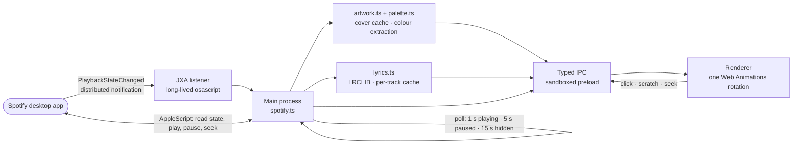

# Spotify Widget

The current Spotify album as a vinyl record on the macOS desktop: it spins at 33⅓ RPM, scratches to seek, and needs no login or API key.

[](https://github.com/samarthpaliwal/SpotifyWidget/actions/workflows/ci.yml)


<!-- TODO: add a capture of the widget. Steps are in docs/README.md.
<p align="center"></p>
-->

## Problem

Spotify's own window is the wrong shape for a glance.
Third-party "now playing" widgets usually go through the Web API, which means registering an app, OAuth,
a login and stored tokens, and they still learn about a track change only on their next poll.

## Approach

Talk to the Spotify desktop app directly through its AppleScript interface, so there is nothing to sign in
to, and listen for the notification Spotify already broadcasts when playback changes.



- **Instant updates without an API.** A JXA helper subscribes to Spotify's distributed notification; a
  sleep-aware poll backs it up for position and for seeks made inside Spotify.
- **A real desktop widget.** The window sits on the macOS desktop-widget layer, above the wallpaper and
  below every app, at the exact system widget sizes, and snaps onto the widget grid.
- **Colour from the artwork.** A dependency-free, saturation-weighted histogram picks the palette; text
  flips between light and dark on its luminance.
- **Cheap to leave running.** The spin is one Web Animations rotation with no per-frame JavaScript, and
  everything pauses when the window is hidden.

## Results

- Zero runtime dependencies; Electron, esbuild and TypeScript are build-time only.
- Two kinds of network request in total: album art from Spotify's CDN and lyrics from LRCLIB.
- Scratch to seek (one full turn is 30 s), synced lyrics, three sizes matching macOS widgets
  (180×180, 360×180, 360×360), desktop or floating level, launch at login.

No automated tests yet; CI type-checks and bundles. `test/harness.html` runs the real renderer against a
mock bridge for manual checks.

## Quick start

Requires macOS 13 or newer, Node 18 or newer, and the Spotify desktop app.

```bash
git clone https://github.com/samarthpaliwal/SpotifyWidget.git
cd SpotifyWidget
npm install
npm start
```

`npm start` bundles with esbuild and launches Electron. Start a track in Spotify and allow the Automation
prompt (see Permissions below). To build a standalone app:

```bash
npm run build      # out/mac-arm64/SpotifyWidget.app, or out/mac/ on Intel
```

### Dependencies (all dev-time, zero runtime deps)

| package | why |
| --- | --- |
| `electron` | the app shell (frameless transparent window, tray, IPC) |
| `esbuild` | bundles the three TypeScript entry points (main, preload, renderer) in milliseconds |
| `typescript` | type checking (`npm run typecheck`) |
| `electron-builder` | packages `SpotifyWidget.app`, writes Info.plist additions and entitlements |
| `@types/node` | Node typings for the main process |

Palette extraction uses Electron's built-in `nativeImage` to decode the JPEG and a small histogram
quantizer (`src/main/palette.ts`), so no image library is needed.

## Permissions (Automation)

The first time the widget talks to Spotify, macOS shows a prompt:
*"SpotifyWidget" wants access to control "Spotify"*. Click **Allow**.

If you dismissed it or it never appeared, enable it manually:

**System Settings → Privacy & Security → Automation → SpotifyWidget → Spotify (on)**

In development (`npm start`) the prompt and the entry are for **Electron** (or your terminal app,
depending on how it was launched) rather than SpotifyWidget. If you deny the prompt, the widget shows
"Nothing playing" and logs `Not authorized to send Apple events` in the terminal; fix it in the panel
above and restart the widget.

The packaged app ships `NSAppleEventsUsageDescription` in Info.plist and the
`com.apple.security.automation.apple-events` entitlement (see `build/entitlements.mac.plist`). The
build is unsigned (`identity: null`); the first launch may need right-click → Open.

## Using it

| action | how |
| --- | --- |
| Play / pause | click the record, or the ▶︎/❚❚ button (buttons appear on hover) |
| Scratch / scrub | grab the record and turn it: one full turn = 30 s, and Spotify follows live while you turn |
| Next / previous | hover buttons |
| Scrub | click or drag on the progress bar |
| Move the card | drag anywhere on the card background; on release it snaps onto the macOS desktop-widget grid, right beside your other widgets |
| Everything else | the vinyl icon in the menu bar |

Sizes match macOS desktop widgets exactly: small 180×180, medium 360×180, large 360×360 frames
(344×164 visible for medium, same inset as the system widgets).

Menu-bar items: Show/Hide widget · Size (small / medium / large) · Background style · Show lyrics ·
Position (On the desktop / Float above windows) · Click-through · Launch at login · Quit.

The window position, size preset and all settings persist in
`~/Library/Application Support/SpotifyWidget/settings.json` (Electron's `userData`). Artwork and
palettes are cached in `.../SpotifyWidget/artwork/`, one JPEG + JSON per track, fetched once.

## Lyrics

Tray → **Show lyrics** shows the previous, current and next line in the card, synced to playback.
Lyrics come from [LRCLIB](https://lrclib.net), a free open lyrics database that needs no API key:
the track is looked up by title, artist, album and duration (titles like "Song - Remix" are retried
without the suffix). Time-synced lyrics are preferred; plain lyrics advance in proportion to the
song's progress. Each track is looked up once and cached in `.../SpotifyWidget/lyrics/`. When
LRCLIB has nothing for a song the card simply shows no lyrics. This and the album art download
(`i.scdn.co`) are the only network requests the widget makes.

## Customising

| what | where |
| --- | --- |
| Spin speed | `SPIN_MS` in `src/renderer/renderer.ts` (1800 ms ≈ 33⅓ RPM; 1333 ms ≈ 45 RPM). |
| Scrub sensitivity | `SECONDS_PER_TURN` (30 s per full turn) and `LIVE_SEEK_MS` in the same file. |
| Deceleration time | `RAMP_MS` in the same file (default 600 ms). |
| Fallback colours (Spotify green accent) | `FALLBACK_PALETTE` in `src/main/palette.ts` and the `:root` tokens at the top of `src/renderer/styles.css`. |
| How the palette is picked | `extractPalette()` in `src/main/palette.ts` (saturation-weighted histogram). Delete `.../SpotifyWidget/artwork/*.json` to re-extract cached palettes. |
| Background look | `.bg-art`, `.bg-gradient`, `.bg-glow`, `.frost` rules in `styles.css`. The blur is `filter: blur(40px) saturate(1.4)` on an image scaled 1.4×. |
| Default background style / size / position | `DEFAULTS` in `src/main/settings.ts`; at runtime use the tray menu. |
| Window sizes | `SIZE_PRESETS` in `src/shared/types.ts` (set to the macOS widget frames) and the `body[data-size]` rules in `styles.css`. |
| Crossfade durations | `.bg-layer` (800 ms) and `.art` (600 ms) transitions in `styles.css`. |
| Polling intervals | `schedule()` in `src/main/spotify.ts` (1 s playing, 5 s paused/closed, ≥15 s hidden). |

## Implementation notes

* **Instant updates.** A long-lived `osascript -l JavaScript` helper subscribes to the
  `com.spotify.client.PlaybackStateChanged` distributed notification and prints a line per event;
  the main process re-reads the full Spotify state on each line. Polling backs this up: ~1 s while
  playing (position), ~5 s when paused or when Spotify is not running, ≥15 s when the widget is hidden.
  Spotify is never launched: `pgrep -x Spotify` is checked before every Apple Event.
* **Units.** Spotify reports `duration` in milliseconds and `player position` in seconds. The main
  process keeps both as-is (`durationMs`, `positionSec`) and the renderer converts.
* **Spin.** One Web Animations API rotation on a `will-change: transform` layer. Pause eases
  `playbackRate` to 0 over 600 ms and then pauses the animation, so the angle is preserved; resume
  eases it back to 1. Track changes crossfade the art without touching the angle. There is no
  per-frame JavaScript except during the 600 ms ramp. When the window is hidden everything pauses.
* **Background.** Two stacked layers (blurred art + dominant→dark gradient + radial glow). A track
  change fills the inactive layer, waits for `img.decode()`, then flips a class: an 800 ms opacity
  crossfade. Text colour flips between white and near-black based on the luminance of the extracted
  palette, and a dark/light scrim always sits between background and text.
* **Ads** (`spotify url` starting with `spotify:ad`, or empty artist) show a grey "Ad" state with a
  dimmed, stopped disc. Local files with no art show the album name on a dark disc.

`npm run palette-test` prints the extracted palette for every cached cover, handy when tuning
`extractPalette()`.

## Tech stack

Electron, TypeScript, esbuild, AppleScript and JXA, Web Animations API. No runtime dependencies.

## Project structure

```
src/
  main/
    main.ts            wires everything, typed IPC handlers, power and sleep handling
    spotify.ts         osascript reads and controls, JXA notification listener, poll scheduler
    artwork.ts         artwork download and disk cache keyed by track id
    lyrics.ts          LRCLIB lookup, LRC parsing, per-track cache
    palette.ts         dependency-free colour extraction
    window.ts          frameless transparent window, desktop or floating level, snap-to-grid
    desktopWidgets.ts  finds macOS's own desktop widgets for level and snapping
    tray.ts            menu bar icon and menu
    settings.ts        JSON settings store
    preload.ts         contextBridge (contextIsolation on, nodeIntegration off, sandbox on)
  renderer/            index.html, styles.css, renderer.ts: the card, spin, crossfades, seek
  shared/types.ts      IPC payloads, settings, size presets
scripts/               build, signing and debugging helpers
test/harness.html      runs the real renderer against a mock bridge in a browser
docs/                  media
```

## Known limitations

* Spotify only. Apple Music, browser players and Spotify Connect targets without the desktop app are not supported.
* Spotify's `player position` AppleScript property is only accurate to about one second, so the
  progress bar can jump by a fraction of a second after a seek or when a notification arrives.
* The distributed notification is sent only on track/state changes, not on seeks made inside
  Spotify; those are picked up by the 1 s poll.
* Desktop mode uses the same window level as macOS's own desktop widgets, so it stacks with them,
  but it is not a WidgetKit widget: it does not appear in the widget gallery or Notification Center,
  and macOS will not reflow its own widgets around it.
* Click-through mode makes the whole card ignore the mouse; use the tray menu to turn it off again.
* The packaged app is unsigned and not notarised. Gatekeeper may require right-click → Open once.
* Hardened-runtime signing (`identity: null` now) would be needed for distribution; add your
  Developer ID to the `mac` section of `package.json`.
